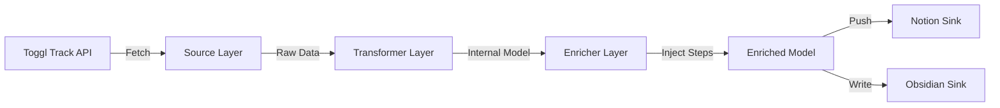

**Project Requirements Document (PRD)** **v1.5**

---

# Notes Sync (v1.5)

> **Project Status**: Notes Sync (v1.5)
> **Architecture**: Toggl-Master / Dual-Write / State-Driven / Service-Oriented
> **Last Updated**: 2026-01-05

## 1. 项目概述 (Overview)

Antigravity Sync Engine 是一个高鲁棒性的个人数据同步引擎。它的核心使命是将 **Toggl Track** 中的客观时间数据，并行、无感地同步到 **Notion**（可视化看板）和 **Obsidian**（永久知识库）。

---

## 2. 系统架构 (Architecture)

### 2.1 核心流程 (Pipeline)

### 2.2 模块设计

- **Source**: 负责从外部 API (Toggl) 拉取原始数据，处理分页与重试。
- **Transformer**: 将原始 JSON 转换为内部统一据模型 (Pydantic Models)。
- **Enricher**: 数据增强层，负责合并本地步数、计算睡眠状态等衍生数据。
- **Sink**: 输出层，适配不同平台的写入逻辑 (Notion API / Obsidian Markdown)。

## 3. 核心功能与数据模型

### 4.1 时间数据同步 (Core Sync)

脚本从 Sources 拉取数据后, 生成中间对象并分发.

#### 4.1.1 字段映射表 (Field Mapping)

FIELD_MAP 定义在
`src/notes_sync/infrastructure/sinks/notion/diary_trans.py`
`src/notes_sync/infrastructure/sinks/obsidian/diary_trans.py`

#### 4.1.2 智能作息分析 (Sleep & Wake Logic)

基于 Toggl 时间点自动推算, 拒绝主观判断.
`src/notes_sync/infrastructure/processors/sleep/enricher.py`

#### 4.1.3 Steps 数据单增, 不回撤

### 4.2 文档模板

- Notion: `docs/references/eg_notion.md`
- Obsidian: `docs/references/eg_obsidian.md`

### 4.3 Mock 数据源

- Toggl: `src/notes_sync/infrastructure/toggl/mock_source.py`

## 5. 🛡️ 功能特性

### 归档保护 (Archive Protection)

当 Notion 或 Obsidian 中的日记被标记为 `status: Archived` 时，同步程序会自动跳过该日期，**绝对不会覆盖**已归档的内容。
